# AI-DataHub 全貌架构设计（Architecture Overview）

> 面向读者：需要一次性看懂本平台「分层结构 / 各层核心逻辑 / 安全围栏 / 身份与权限模型」的人。
> 事实来源：当前代码（`backend/`、`frontend/`、`docker/`、`tests/`）。每节末尾给出**代码锚点**，
> 结论可核对。文档只描述**已落地**的形态，计划稿单独标注 `[计划]`（见 §10）。
> 强规范口径见 `.qoder/rules/`（安全护栏、本体建模、AS-BOT 定位、数据源分域、图可视化、禁止降级掩盖、FDE 演进）。
>
> **演示版（HTML）**：打开 [`ARCHITECTURE_OVERVIEW.html`](ARCHITECTURE_OVERVIEW.html)（单文件、内联矢量图、目录导航/明暗切换/可打印）。
> 本 markdown 仍是**唯一事实源**，HTML 由 `node docs/build-architecture-html.mjs` 从本文自动生成（改完本文重跑一次即可）。

## 图索引（矢量大图 + Mermaid 源码）

四张矢量图（`docs/architecture/*.svg`，浏览器/IDE 直接打开可缩放）与对应 Mermaid 源码互为镜像，**改一处需同步另一处**：

| 矢量图 | 内容 | 对应章节 |
|---|---|---|
| 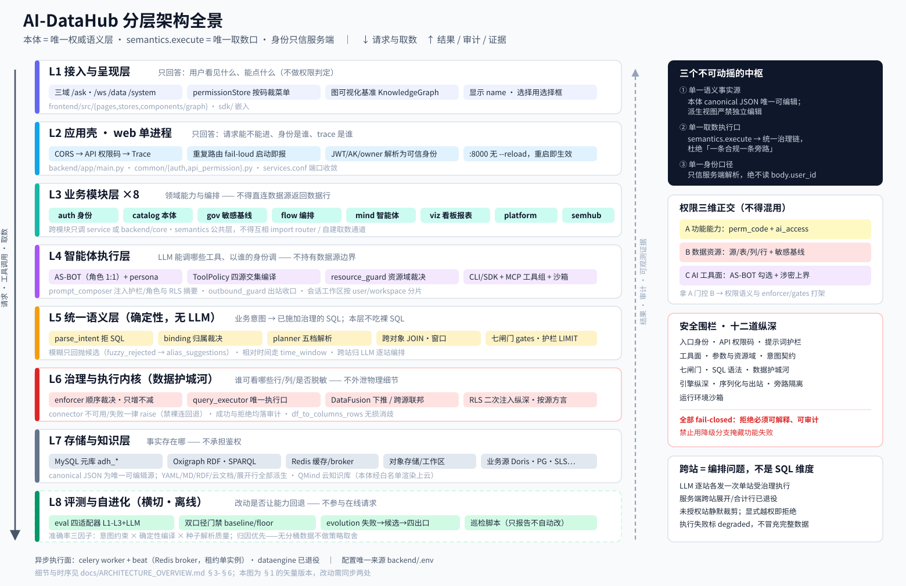 | L1-L8 分层全景 + 三个中枢 + 围栏/跨站摘要 | §1 §2 |
| 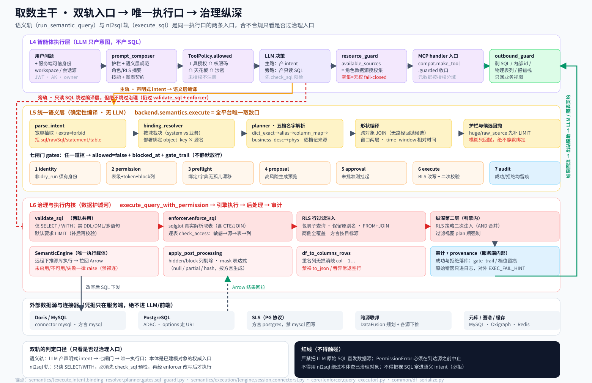 | 双轨入口 → L4/L5/L6 逐环节 → 唯一执行口 → 出站回流 | §3 §4 §5.2 §6 |
| 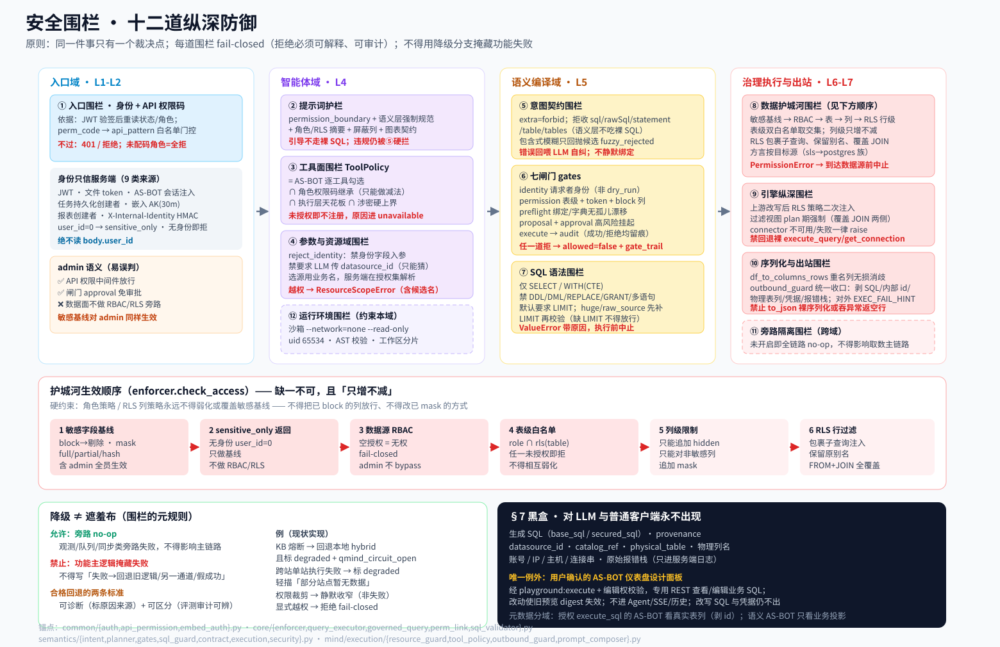 | 十二道纵深防御 + 护城河顺序 + 降级边界 + §7 黑盒 | §5 |
| 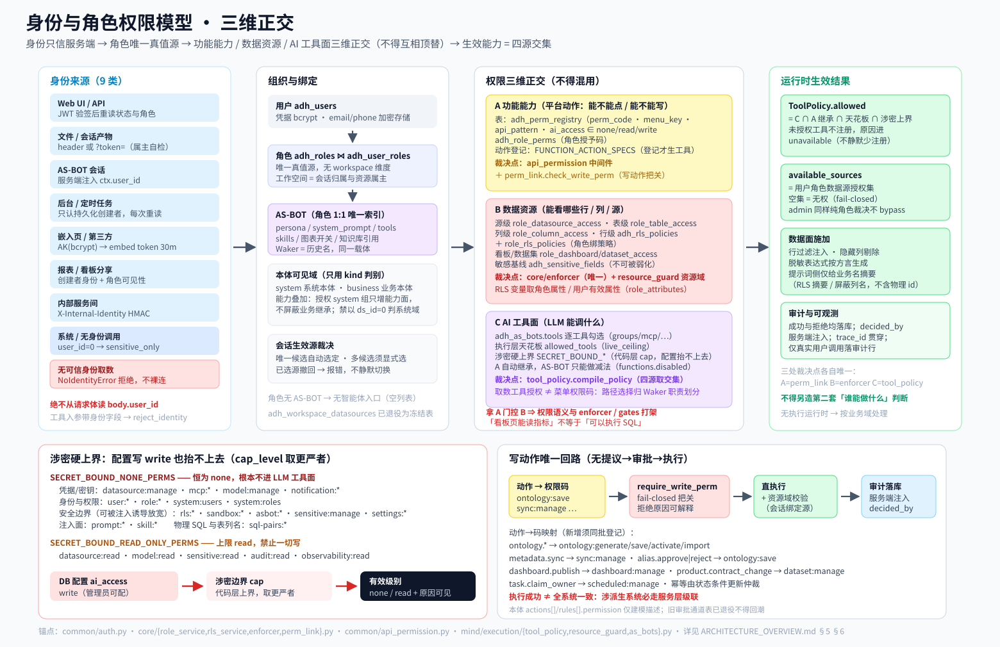 | 身份9源 + 角色链→AS-BOT + 三维正交 + 涉密上界 + 写回路 | §6 |

> 矢量图专为“贴墙/评审汇报一眼看懂”设计；需要可 diff、可改的图定义时用下方的 Mermaid 块。

---

## 0. 一句话定位

**AI-DataHub = 以「本体（Ontology）」为唯一权威语义层的 governed ChatBI / 数据中台。**
它不是数据库连接工具：任何能返回数据行的路径，都必须经过统一取数执行口并施加
「敏感基线 → RBAC → 列级 → RLS 行级 → 审计」的治理链（下称**数据护城河**）。

三个不可动摇的中枢设计：

| 中枢 | 含义 | 代码锚点 |
|---|---|---|
| 单一语义事实源 | 本体 canonical JSON doc 是唯一可编辑源，YAML/MD/RDF/云文档/展开行全部是派生视图 | `backend/modules/catalog/services/ontology_service.py` |
| 单一取数执行口 | `backend.semantics.execute` 是全平台唯一取数口，内部收口 `execute_query_with_permission` | `backend/semantics/execute.py`、`backend/core/query_executor.py` |
| 单一身份口径 | 身份只信服务端（JWT / 嵌入 AK / 任务 owner / 报表创建者），绝不从请求体读 `user_id` | `backend/common/auth.py`、`backend/common/embed_auth.py` |

---

## 1. 顶层分层架构


下方 Mermaid 为同一结构的源码版（可 diff / 可编辑）。

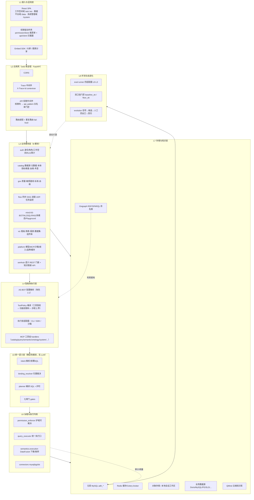

**分层职责一句话**

| 层 | 只回答这个问题 | 不做什么 |
|---|---|---|
| L1 | 用户看见什么、能点什么 | 不做权限判定（只消费后端返回的码/数据） |
| L2 | 请求能不能进、身份是谁、trace 是谁 | 不做业务规则 |
| L3 | 领域能力与 CRUD/编排 | 不直连数据源返回数据行 |
| L4 | LLM 能调哪些工具、以谁的身份调 | 不持有数据源边界（权限跟用户角色） |
| L5 | 业务意图如何确定性编译成受治理 SQL | 不含 LLM、不吃裸 SQL |
| L6 | 谁可以看哪些行/哪些列/是否脱敏 | 不向上层泄露物理 SQL 与连接信息 |
| L7 | 事实存在哪 | 不承担鉴权 |
| L8 | 改动是否让能力回退（工程契约见 §4.9） | 不参与在线请求 |

---

## 2. 进程与部署拓扑

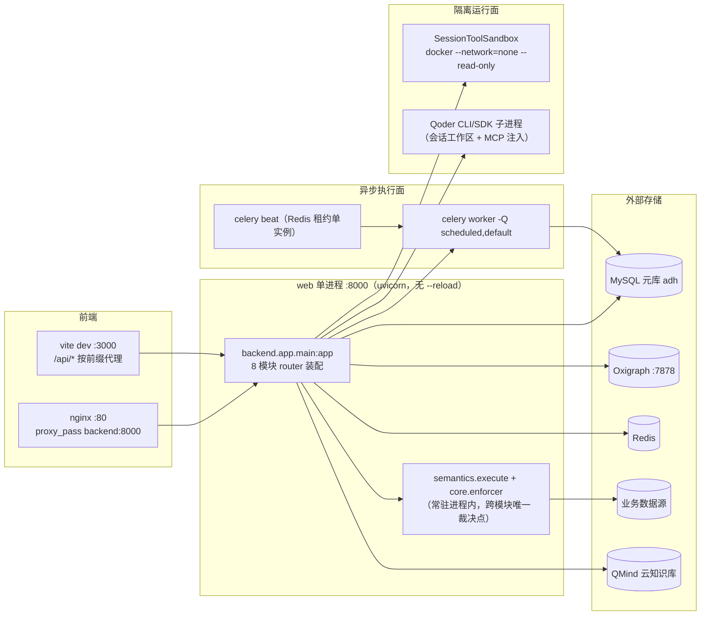

关键事实（可核对）：

- 服务唯一权威清单：`backend/scripts/services.conf`，Phase 4 起所有模块名统一指向 `backend.app.main`，端口收敛为单一 web 端口（当前 `:8000`，`ss -ltnp` 实测只有一个 python 监听）。旧的 8 个进程壳已删除，`name:` 列仅作 CLI 别名。
- web 进程**无 `--reload`**：改接口/权限代码后 `./stop-all.sh web && ./start-all.sh -d` 重启即全局生效（治理逻辑常驻进程内，无旁路缓存跨进程）。
- 启动 lifespan 三件事：`ensure_seeded()` 内置任务落库、KB 对账循环（默认关闭，`KB_SYNC_RECONCILE=1` 才开）、Waker 会话恢复 + 工具沙箱预热。
- 配置唯一来源：`backend/.env`（经 `backend/common/config.py`）。
- 前端代理按前缀分流并给 `/api/chat`、`/api/as-bot`、`/api/execution`、`/api/pipeline` 设 600s 超时（流式长任务）。

---

## 3. 请求主干：一次「智能问数」的端到端时序

> 矢量版：（双轨入口、逐环节泳道、七闸门与护城河纵深、结果回流出站脱敏）

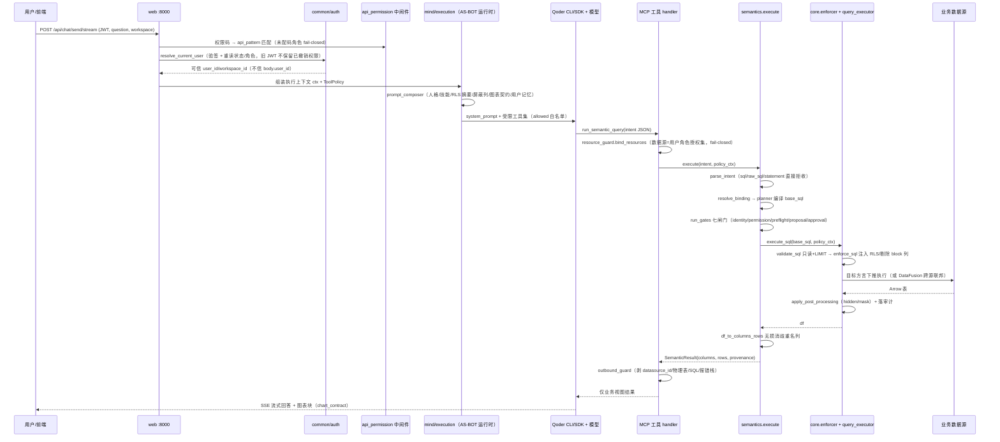

阶段归属对照：`1-3 身份与入口` → L2；`4-6 策略与提示词` → L4；`7 LLM 只产意图` → L4；
`8-13 编译与闸门` → L5；`14-18 治理执行` → L6；`19-21 出站脱敏与呈现` → L1/L4。

---

## 4. 各层核心逻辑

### L1 接入与呈现层

- 三条路由域：`/ask`、`/ws/:workspaceId`（工作空间：Chat/资产/调度/报表）、`/data`（数据平台：数据源/表/本体/指标/数据集/质量/血缘/RLS/同步/DAG/Playground/图谱）、`/system`（系统：用户/角色/模型/MCP/AS-BOT/技能/知识库/审计/可观测/评测/进化/沙箱/看板管理）。旧 `/system/wakers`、`/system/agents` 重定向到 `/system/as-bots` —— **Waker 与 AS-BOT 是同一载体的历史名**。
- 权限消费方式：`stores/permissionStore.ts` 按后端返回的权限码裁菜单与按钮；**前端不做裁决**，只做呈现收窄。
- 图可视化统一基准：`components/graph/KnowledgeGraph.tsx`（BaseEdge+getBezierPath、`fill:none`、度 sized 圆点、标签在点下方、图例可点选按类型筛选），血缘走 dagre LR 分层，图谱走力导向。
- 显示纪律：一切资源引用显示 name，ID 只进 `title`；选择一律用选择框（选项来自清单接口），不得手输内部 id。
- 结果渲染纪律：`MarkdownWithCharts` + `chart_contract` 固定图表 JSON 形状；序列化字段按 `columns/rows` 消费（重名列已由后端 `col__1` 消歧）。

### L2 应用壳（单进程装配）

- `create_app()` 按模块 `mount(tag, router, prefix)`，装配后执行 `assert_no_duplicate_routes()`：跨模块真撞（精确重复或路径模式互匹配遮蔽）**启动即抛错**，不允许 FastAPI 的"静默首匹配"。
- 中间件链（外→内）：CORS → `add_api_permission_middleware` → `_trace_middleware`（`set_trace_id()` 写 contextvar，`call_next` 前置入，传播到流式生成器与子 task）。
- 真撞裁决记录在文件头（例：`/api/admin/sync/metadata` 由 catalog 真实现承载；platform 技能模板与 mind 技能管理真撞且消费方为 0 → 不挂载并已退役）。

### L3 业务模块层（8 模块）

| 模块 | API 前缀 | 核心职责 | 关键服务 |
|---|---|---|---|
| auth | `/api/auth` `/api/users` `/api/roles` `/api/workspaces` `/api/audit` `/api/admin`(RLS/knowledge) `/api/observability` `/api/eval` | 身份、角色、工作空间、RLS 策略配置、审计、评测入口、可观测查询 | `auth_service` `rbac_service` `observability_service` |
| catalog | `/api/catalog` `/api/admin/*`(metadata/templates/terms/relations) `/api/metrics` `/api/tags` `/api/datasources` `/api/menu` `/api/evolution` | 数据源登记、元数据同步、本体建模（唯一可编辑源）、指标/维度字典、术语、血缘、数据产品（L1 治理身份）、自进化 | `ontology_service` `ontology_kb_sync` `metadata_sync` `metrics_service` `data_product_service` `evolution_service` |
| gov | `/api/quality` `/api/lineage` `/api/standards` `/api/security` | 数据质量规则引擎、血缘持久化、**敏感字段基线** `adh_sensitive_fields` 的识别与建议 | `quality_engine` `lineage_service` `sensitive_suggest` |
| flow | `/api/sync` `/api/dag` `/api/scheduled-tasks` `/api/notification` `/api/task-monitor` `/api/udf` `/api/report-templates` | 同步任务与水位线、DAG 编排（planner/validator/node_runners/sql_translator）、Celery 调度、通知、任务监控、UDF 注册表 | `sync_service` `dag/*` `scheduled_task_service` `beat_schedule` |
| mind | `/api/chat` `/api/playground` `/api/as-bot` `/api/execution` `/api/history` `/api/pipeline` `/api/assets` `/api/workspace-assets` `/api/admin/skills` | AS-BOT 会话与运行时、NL2SQL、RAG 检索、多模态解析、技能/知识库管理、用户资产 | `execution/*`（见 L4）`rag/*` `nl2sql/*` `services/chat_service` |
| viz | `/api/dashboard` `/api/charts` `/api/reports` `/api/datasets` `/api/vis-library` `/api`(component-data) | 看板/图表/快照、报表与分享、BI 消费数据集、可视化组件库、仪表盘设计（AS-BOT 例外域） | `dashboard_service` `report_service` `dashboard_design_service` `component_service` |
| platform | `/api/admin/mcp-servers` `/api/mcp-market` `/api/embed` `/api/model-train` `/api/admin/model-config` `/api/admin/brand` `/api/admin/cache` `/api/admin/execution-layers` `/api/admin/prompts` `/api/admin/as-bots` `/api/sandbox` | MCP 服务器与市场、嵌入 AK、模型中心、执行层登记、提示词版本化配置、AS-BOT 配置面、沙箱环境、品牌与缓存 | `mcp_server_service` `sandbox_executor` `model_config_service` `embed_service` |
| semhub | `/api/semantic/*` `/api/graph` | 语义层跨语言 REST 门面（`/schema` 导出 JSON Schema、`/resolve` 编译预览、`/query` 执行、`/health`）、知识图谱读写与同步 | `semhub/graph/graph_service` `graph_sync_service` |

模块间契约：跨模块只调 service 函数或走 `backend/core/*`、`backend/semantics/*` 公共层，**不得**互相 import API router，不得绕过 `semantics.execute` 自行开取数通道。

### L4 智能体执行层（mind/execution）

这是"LLM 作为同一载体、不同入口"的落点，四个关键机制：

1. **AS-BOT 解析（`as_bots.py`）**：`adh_as_bots` 按 `as_bot_key` 存配置单元（persona、system_prompt、tools、图表开关、skills、知识库引用），`role_id` 唯一索引 → **角色与 AS-BOT 一对一**。写动作的"提议→审批→执行"回路已退役，改为权限码 + 工具授权直执行。
2. **ToolPolicy 编译（`tool_policy.compile_policy`）**：最终 `allowed` 集合 = 四个来源的交集，任一未授权即不注册，且把不可用原因写进 `unavailable`（不静默少注册）：
   - AS-BOT 逐工具勾选 `tools.mcp` / `groups` / `standard` / `external`；
   - 功能能力从**角色权限码自动继承**（`perm_link.resolve_function_actions`，AS-BOT 只能做减法 `functions.disabled`）；
   - 执行层天花板 `ceiling`（`live_ceiling` 取运行时白名单）；
   - 涉密硬上界 `SECRET_BOUND_*`（配置写 `write` 也抬不上去）。
   判定口径两个正交问题：`_as_bot_can_write_sql(policy)`（是否授权 `__execute_sql`）决定元数据返回物理视图还是业务投影；`is_system_scope(policy)`（是否授权 `system` 工具组）决定系统能力面是否**叠加**（能力叠加，不屏蔽业务）。
3. **资源域守卫（`resource_guard.py`）**：`bind_resources` 返回**用户角色授权集**（唯一裁决点，工作空间不再绑源、AS-BOT 不持有边界）；`validate_tool_resources`/`_check_source` 逐参数拒绝越权源与内部 id；`assert_ontology_draft_scope` 只裁资源域（动作把关交给权限码）；`reject_identity` 禁止工具入参携带身份字段。
4. **执行后端（`manager.py` + `adapters/*` + `secure_sdk.py` + `sdk_tools/*`）**：`ExecutionLayerAdapter` 抽象（builtin/cli/docker/remote），当前主用 Qoder CLI/SDK 子进程 + 会话内 MCP server（`sdk_tools` 按组注册：catalog/query/semantic/ontology/system/dashboard_design/memory/asset/external…）。会话工作区目录 `{ADH_WORKSPACES_DIR}/{user_id}/workspace/{workspace_id}/...`，Python 代码执行走 `--network=none --read-only` 容器沙箱，构建期固化依赖。
   工具结果统一出口 `compat.make_tool.guarded` → `outbound_guard` 做**基础设施/凭据/内部标识**脱敏收口（与业务数据 PII 的敏感列基线分工不同，前者不匹配 PII 正则）。

**提示词组装（`prompt_composer.compose_system_prompt`）**：护栏（`adh_prompts` category=permission_boundary，全局默认+工作空间覆盖）+ 人格 + 技能/SKILL.md + 快速路径 + 图表契约 + **当前用户角色与权限摘要** + `_rls_scope_lines`/`_blocked_columns`（让 LLM 知道作用域边界，但仍不传物理 id）+ 知识库清单 + 用户记忆 + `SEMANTIC_QUERY_RULES`（强制走 `run_semantic_query`、禁止自写 SQL、名称权威以 `get_metrics` 实时目录为准）。

### L5 统一语义层（backend/semantics）

**确定性编译，无 LLM 参与**：LLM 只产意图，本层负责把意图变成"已施加治理的 SQL"。

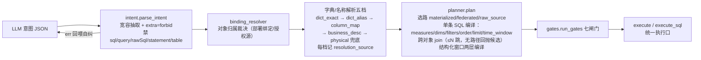

- 解析纪律：**包含式模糊只回抛候选**（`fuzzy_rejected` + `fuzzy_hint`）并落 `adh_alias_suggestions`，绝不静默绑定（宁缺勿错）。
- 护栏编译：`force_limit`/`size_class=huge`/`query_mode=raw_source` → `bounded_query` 先补/收紧 LIMIT **后再校验**，缺 LIMIT 的扫描不得直接放行。
- 相对时间用 `time_window`（`7d/24h/2w/1M`），禁止 LLM 手算绝对日期。
- 契约：`SemanticQuery`/`SemanticResult` 全部 `extra="forbid"`，`contract.py` 导出 JSON Schema 供前端/外部 CI 生成类型；错误码只增不改；对外失败文案唯一口径 `EXEC_FAIL_HINT`。
- 闸门产物 `SemanticExecution` 含 `gate_trail`/`provenance`/`applied_rls`/`masked_columns`（`secured_sql`/`base_sql` **不得**外发，护栏 §7）。
- 跨站（v0.5）：`cross_site.py` 只保留**只读派生清单**（对象 × 站点，事实源 `adh_ontology_bindings` + `adh_data_products.site`），作为 `get_metrics.deployments` 顺风车字段给 LLM 编排；服务端跨站展开/合并已退役并有测试锁定，不得再引入。

### L6 治理与执行内核（backend/core + semantics/execution + semantics/security）

- `validate_sql`：仅 `SELECT`/`WITH`，禁 DDL/DML/多语句，默认要求 `LIMIT`。
- `enforcer.check_access` 顺序（缺一不可，且**只增不减**）：
  1. 敏感字段基线（`adh_sensitive_fields`：`block`→并入 hidden、`mask` full/partial/hash）— **对所有人生效含 admin**；
  2. `sensitive_only`（无身份 user_id=0）在此返回（只做基线，不做 RBAC/RLS）；
  3. 数据源级 RBAC（fail-closed：空授权 = 无权，历史缺陷已修）；
  4. 表级白名单交集（role 白名单 ∩ RLS table 策略）；
  5. 列级限制（hidden/masked，**不得覆盖**敏感基线的列与方式）；
  6. RLS 行过滤 → SQL 改写。
- `enforce_sql`：总是用 sqlglot **真实解析**取表（调用方传的表清单不能省略 JOIN/CTE 内的表），方言**按目标源** `dialect_of_db_type(db_type)`（sls→postgres 族；用错方言会破坏 `ARRAY[]`/双引号标识符）。RLS 以包裹子查询注入，**保留原别名**、覆盖 FROM 与 JOIN 两侧（禁 `AS t t1` 非法双重别名）。
- 纵深防御：`_execute_via_semantic_execution` 在上游 `enforce_sql` 之后**再次加载 RLS 策略并注入**（`load_rls_policies_for_query` + `inject_filters`），hidden/mask 由 `apply_post_processing` 施加；解析/注入失败**保守上抛拒绝**，不降级裸执行。
- 执行引擎：`semantics.execution.SemanticEngine` 是唯一执行载体（远程下推拉回 Arrow / 跨源 DataFusion 联邦），**未启用/不可用/失败一律 raise 显式暴露**，禁止回退 pymysql 直连；`SessionPool` 按 `policy_fingerprint` 分桶，治理层 `security/policy_views.py` 把裁决产物注册为**过滤视图**（plan 期强制、天然覆盖 JOIN 两侧），`security/masking.py` 按执行方言生成 mask 表达式。
- 序列化：`df_to_columns_rows` 无损消歧重名列（`col__1…`），禁止裸 `df.to_json(orient="records")` 或吞异常返回空行。
- 审计：成功与拒绝均落 `adh_query_audit`/`adh_data_access_audit`；仅真实用户调用落审计行；`policy_id` 数字进数值列、字符串标记进 `policy_name`。

### L7 存储与知识层

- 元库 MySQL（`adh_*` 约 110+ 张表，见 §8）。
- Oxigraph RDF 图库：按命名图分区（`<adh:ds:{id}>` → 收敛为业务/系统二分 `[计划]`）；节点模型 `adh:Table/adh:Column/adh:Term/adh:Metric/adh:SQLTemplate` + `hasColumn/join/mapsTo/defines/touchTable`；`common/rdf/ontology_to_rdf.py` 把本体投影成 RDF（`owl:oneOf` 只是枚举的只读投影）。
- 检索策略（`mind/rag`）：默认 `graphrag` 已收缩为**确定性 by-name 元数据回填**（agentic LLM 写 SPARQL 探图已退役）；`ontology_traversal` 单趟完成「分词+同义词 → CONTAINS 命中 owl:Class → 一条 SPARQL 属性路径闭包 ≤2 跳 → 对象映射物理表 → 复用 GraphRAG 装填」；`business_route` 从 canonical doc 读路由（**不从知识库文本回传**，KB 可能 stale）；`terminology_manager.expand_synonyms(keywords, datasource_id)` 按源分桶（ds=0 视为全局）；`bm25` + jieba 关键词路线，无向量/无 embedding（`retire_embedding_columns_migration.sql`）。
- Redis：TTL 缓存层（`common/cache`、`ttl_cache`）+ Celery broker/result + Beat 单实例租约。
- 对象存储 / 本地兜底：附件与用户资产 `ai-datahub/{userId}/assets`，会话工作区 `data/user/`。
- QMind 云端知识库：本体 → `to_cloud_md`（白名单渲染 + `model-version-stamp`）→ `ontology_kb_sync` 推送，水位线落 `adh_ontology_kb_sync_state`；当前用户拍板**纯手动同步**（`KB_SYNC_RECONCILE` 默认关）。

### L8 评测与自进化闭环

- 四个适配器（`backend/eval/adapters`）覆盖不同层，报告分开呈现、不得互相背书：
  `compile`(L1 纯离线编译，fixture 打桩，`sources` 分桶=**planner 解析档位**)、
  `semantic`(L2 真实本体/字典/敏感/RLS 配置，**不打桩**)、
  `retrieval`(L3 真跑检索策略，强制清进程内缓存防假阳性，分桶=**检索来源**)、
  `llm`(轨迹回放 trace / 真实 handler / 真实 LLM；断言该调的调了、涉密被拒、出站无泄露)。
- **双口径门禁（正交，不得顶替）**：`baseline_ok` = 相对上次完成运行未回退；`floor_ok` = 绝对正确率下限 `floor_accuracy` **且** 活跃用例数达 `min_cases`（专门拦"删难用例刷通过率"）。历史上出现过"14 条只过 5 条却报绿"，因此发布结论一律看 `release_ok`。`passed` 由确定性断言给出，`score`（LLM 辅助）不影响 `passed`；落库失败抛 `EvalStoreError`（结果丢了却报通过 = 降级掩盖）。
- 自进化（`evolution_service` + `adh_message_feedback`/`adh_alias_suggestions`/`adh_evolution_candidates`）：信号采集 → 定时归纳候选（每条写 `classify_reason`）→ 人工四出口审核 → 回归验证。候选 `target_ref` 为空的真实缺口（指标还没建）也可审核落库。
- 定期巡检脚本：`backend/scripts/check_alias_projection.py`（对象 aliases 源 → 图谱 skos:altLabel 投影一致性，只报告不自动改）。

---

## 4.9 FDE 迭代方法论（贯穿各层的工程契约）

> 定位：上面 L1-L8 是**空间结构**，本节是**时间结构**——平台如何持续演进而不退步。
> 核心口径：准确率不是模型属性，而是**评测驱动的工程质量**；任何 prompt/别名/planner/检索/导入导出
> 的改动都必须能回答“eval 数据上前进了还是退步了”。
> 规范源：`.qoder/rules/fde-evolution.md`（强制）。

### 4.9.1 准确率三因子（改动定位先归因子）

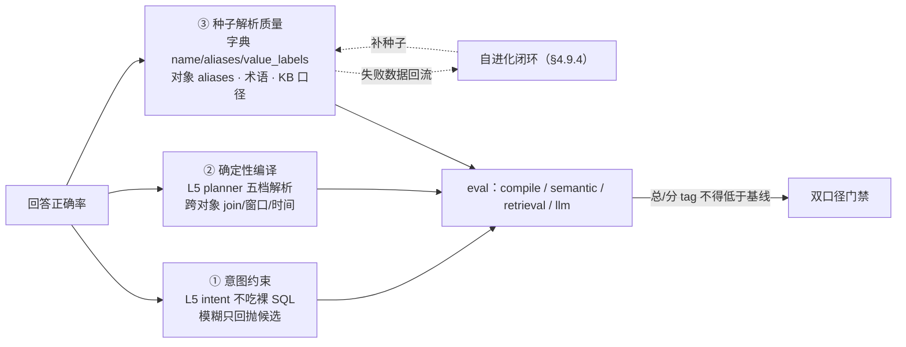

任何一项改动都不得削弱另外两项（例：为“能答上”放宽模糊绑定 = 牺牲①补③，禁做）。

### 4.9.2 Eval 是本体的 CI（不是 tests/ 附属脚本）

| 契约 | 落地形态 |
|---|---|
| 位置与可导入方向 | 评测是**项目内可复用工程能力** `backend/eval/`；生产侧（Celery 业务评测、管理页）正向导入它，**不得**把评测核心放 `tests/` 供反向依赖 |
| 用例与结果存储 | 用例存元库 `adh_eval_cases`（页面可增删改查，**不读 YAML**）；运行结果存 `adh_eval_runs`/`adh_eval_results`，支持版本对比与发布前检查 |
| 四适配器与分桶语义 | `compile`（解析档位 dict_exact/dict_alias/…）、`semantic`（真实本体/字典/基线/RLS，不打桩）、`retrieval`（检索来源 qmind_hit/graphrag/bm25…，强制清进程内缓存）、`llm`（trace/handler/live）。**两类分桶语义不同，报告分开呈现，不得拿编译集通过率为检索层背书** |
| 先度量后优化 | 新解析/检索行为**先加 eval 用例再实现**（或同批落地）；只加功能不加用例视为未完成 |
| 覆盖维度（tag） | exact / alias / enum / time_window / time_grain / template / cross_source / unbound / fuzzy / reject / unresolved(no_leak) / combo |
| 归因优先于调优 | 决策数据源 = `provenance.resolution_sources`（planner 档位）+ `retrieval_source`（`semantic_tools._classify_retrieval_source`）+ observability `kind="retrieval"` span。**没有分桶数据不做任何检索/解析策略取舍** |
| pytest 门禁 | `tests/test_eval_baseline.py` 作为提交拦截点；落库失败抛 `EvalStoreError`（结果丢了却报“通过”= 降级掩盖） |

锚点：`backend/eval/{runner,gate,compare,store,contract}.py`、`backend/eval/adapters/*`、`backend/modules/flow/tasks/eval_tasks.py`（生产侧调度）、`backend/modules/auth/api/eval.py`（管理页入口）。

### 4.9.3 变更执行不造第二通道

写操作（含自进化产出的候选变更：补别名、建对象、改绑定）**只走一条回路**：
菜单与功能权限码（`adh_role_perms` ⋈ `adh_perm_registry.ai_access`，经 `perm_link.require_write_perm` fail-closed）
+ AS-BOT 工具授权 → 直执行 → 审计落库（`decided_by`/`approved_by` 服务端注入）。

- 旧「AS-BOT Action 提议→审批→执行」回路（`adh_as_bot_approvals` / `adh_as_bot_role_actions` / `adh_as_bot_action_registry`）**已退役，不得回潮**；新增自动化/自进化能力时**复用**既有码映射（`metadata.sync`→`sync:manage`、`alias.approve|reject`→`ontology:save`、`dashboard.publish`→`dashboard:manage`、`product.contract_change`→`dataset:manage`），不得另建“直接 UPDATE 元数据表”的旁路。
- **执行成功 ≠ 全系统一致**：涉派生系统（图谱 / qmind 文档 / 绑定表）的动作必走服务层级联（§8 纪律），并有水位线或对账兜底（`ontology_kb_sync.reconcile()` + `adh_ontology_kb_sync_state`）。

### 4.9.4 失败数据驱动建模 backlog（自进化闭环）

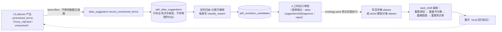

- 建模待办由**失败数据生成**，不靠拍脑袋堆别名；反复“未绑定/找不到对象”的缺口应转化为**本体建模项**，而不是检索侧 hack。
- 当前实回路与继任者的真实接线（代码事实，引用前必读）：

| 环节 | 现状 | 锚点 |
|---|---|---|
| 解析失败落入 | ✅ 已接主链路（`run_semantic_query` 返回后异步落入 `adh_alias_suggestions`） | `sdk_tools/semantic_query.py` L112-113 |
| 候选归纳层继任函数 | ⚠ `evolution_service.record_parse_fail_terms` 自称继任，但**无主链路调用方**（仅 API 层 `catalog/api/evolution.py` 消费） | `catalog/services/evolution_service.py` L331 |
| 直审回写 | ✅ 已接（`ontology:save` 把关后直执行，无审批回路） | `mind/api/as_bot.py` L53/L82 |
| 巡检 | ✅ 只报告不自动改 | `scripts/check_alias_projection.py`、`absorb_business_terms.py` |

### 4.9.5 Fail-safe 与降级守则（与 §5.4 元规则的关系）

- **旁路可以 no-op，功能不可掩藏**：观测/队列/同步类改动不得影响取数主链路（全 try/except + debug/warning，未开启即全链路 no-op）；别名落入/审核全链路 best-effort（失败只记日志）。
- **透明回退的合格标准 = 可诊断 + 行为可区分**：云端知识库不可用/熔断时（`qmind_retriever._breaker_allowed`）透返本地 hybrid 并**显式标注** `degraded=True` + `rag_source` 拼 `qmind_circuit_open`（评测/审计能分辨正常路径与回退路径）——合格回退，不是掩盖。
- **外部依赖按“子进程即脆弱”对待**：超时、失败计数熔断、回退路径三件套缺一不可（qmind CLI 等）。
- **宁缺勿错**：解析拿不准就回抛候选让 LLM 确认，绝不静默绑定（与护栏「错数比无答案危害大」同口径）。

### 4.9.6 阶段门与安全先行

- 结构性增强（Link 参与编译、实例级图谱、多跳）必须先有 **Phase 0/1 度量底座与基线就绪**，按 eval 薄弱点决定投入顺序；未证明收益不做架构级改动。
- 若增强触碰护城河前置缺口（如带 `db.table` 限定名/JOIN 侧的新 SQL 形态，需先升级 `enforcer._extract_tables` 与 RLS 注入覆盖）：**安全升级先行，功能随后**——引入新 SQL 形态而 RLS 未覆盖即安全缺陷。
- 每次迭代收尾必输出：eval 报告（总/分 tag/分来源档位）+ 新增红与修掉的红 + 是否触发回退决策。

---

## 5. 安全围栏设计（Defense in Depth）

> 矢量版：（十二道纵深 + 护城河顺序 + 降级边界 + §7 黑盒）

设计原则：**同一件事只有一个裁决点**，且每一道围栏都是 **fail-closed**（不通过就拒绝并给出可解释原因），
围栏失败**不得**被降级分支掩藏（`.qoder/rules/no-silent-degradation.md`）。

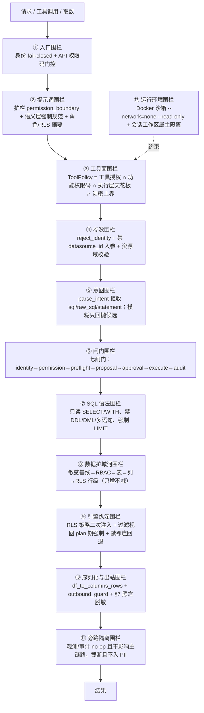

### 5.1 十二道围栏逐条（裁决依据 / 失败语义 / 代码锚点）

| # | 围栏 | 裁决依据 | 不通过时的行为 | 代码锚点 |
|---|---|---|---|---|
| ① | 入口身份 | JWT 验签后**重读**用户状态与角色；工作空间仅作选择，资源访问须服务端授权 | 401/403；旧 token 不保留已撤销权限 | `common/auth.py: resolve_current_user / authorize_workspace / authorize_resource_scope` |
| ① | API 权限码 | `adh_perm_registry.api_pattern` × `adh_role_perms`，admin 放行；未配任何码的角色=全拒（白名单路径除外） | 403（可读原因） | `common/api_permission.py` |
| ② | 提示词护栏 | `adh_prompts(category=permission_boundary)` 全局默认+工作空间覆盖；`SEMANTIC_QUERY_RULES` 声明「只能产意图、禁止自写 SQL」 | LLM 被引导不走裸 SQL；违规仍被 ⑤ 硬拦 | `mind/config/guardrails.py`、`mind/execution/prompt_composer.py` |
| ③ | 工具面 | 四源取交集编译 `ToolPolicy.allowed`；未授权即**不注册**，且原因进 `unavailable` | LLM 无从调用；原因可在 UI 显示 | `mind/execution/tool_policy.py: compile_policy / normalize_tools` |
| ④ | 参数与资源域 | `reject_identity`（禁 `user_id/workspace_id/decided_by` 入 body）；工具入参**禁止**要求 LLM 传 `datasource_id`；选源用业务名，服务端在授权集内解析 | 抛 `ResourceScopeError`（含候选名的可操作文案，不含物理标识） | `mind/execution/resource_guard.py` |
| ⑤ | 意图契约 | `extra="forbid"` + `_FORBIDDEN_KEYS = {sql,query,rawSql,raw_sql,statement,table,tables}`；包含式模糊只回抛候选 | 拒收并把错误回喂 LLM 自纠 | `semantics/intent.py`、`semantics/planner.py` |
| ⑥ | 七闸门 | identity（非 dry_run 必须有请求者身份）→ permission（表级+`permission_token`+block 列显式请求即拒，对 admin 同效）→ preflight（对象已绑定/指标已解析/binding 无孤儿漂移）→ proposal（huge/raw_source/无过滤/写回 生成 ProposedEdit）→ approval（高风险未批准则 `needs_approval` 挂起）→ execute → audit | `allowed=False` + `blocked_at` + `gate_trail`，不静默放行 | `semantics/gates.py: run_gates` |
| ⑦ | SQL 语法 | 仅 `SELECT`/`WITH`；禁 CREATE/ALTER/DROP/TRUNCATE/RENAME/GRANT/REVOKE、INSERT/UPDATE/DELETE/REPLACE、引号外分号多语句；默认要求 LIMIT | `ValueError` 带原因，执行前中止 | `core/query_executor.py: validate_sql`、`core/sql_validator.py` |
| ⑧ | 数据护城河 | 见 §5.2 顺序；表级白名单双源取**交集**；列级只能追加 hidden、只能对非敏感列追加 mask | `PermissionError` → 下发前提中止 + 拒绝落审计 | `core/enforcer.py: _check_access_impl / enforce_sql` |
| ⑨ | 引擎纵深 | 上游改写后**再加载 RLS 策略二次注入**（同表多策略 AND 合并）；视图化强制覆盖 JOIN 两侧；连接器不可用/失败一律 raise | 保守上抛拒绝，禁止回退裸 `execute_query`/`get_connection` | `core/query_executor.py: _execute_via_semantic_execution`、`semantics/security/policy_views.py` |
| ⑩ | 序列化与出站 | 重名列 `col__1…` 无损消歧；工具结果统一过 `outbound_guard`；对外文本过 `LEAK_KEYWORDS` | 原始引擎细节只进服务端日志，对外 `_EXEC_FAIL_HINT` | `common/df_serialize.py`、`mind/execution/outbound_guard.py`、`semantics/contract.py` |
| ⑪ | 旁路隔离 | observability 未开启即全链路 no-op 绝不抛出；span 按 `OBSERVABILITY_SPAN_MAX_CHARS` 截断；跨线程 `contextvars.copy_context().run` 传播 recorder | 旁路失败不得影响取数主链路 | `backend/observability/*` |
| ⑫ | 运行环境 | 会话工具沙箱 `--network=none --read-only`、uid 65534、构建期固化依赖；工作区目录按 `user_id/workspace_id` 分片；AST 代码校验 | 预热失败只 warning（不阻启动），执行期首轮自行报错 | `platform/services/sandbox_executor.py`、`docker/agent-sandbox/Dockerfile`、`mind/execution/session_workspace.py` |

### 5.2 护城河生效顺序（`enforcer.check_access`，缺一不可）

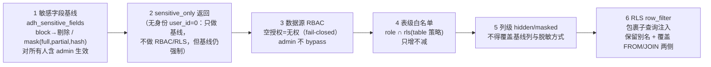

**硬约束**：角色策略与 RLS 列策略**永远不得弱化或覆盖**敏感基线 —— 不得把已 `block` 的列放行、
不得改已 `mask` 的方式；合并时只能追加 hidden、只能对非敏感列追加 mask（`enforcer.py` L213-242 明确该分支）。

### 5.3 §7 黑盒：对 LLM 与普通客户端永不出现在响应里的东西

生成 SQL（`base_sql`/`secured_sql`）、`datasource_id`、`catalog_ref`、`physical_table`、`provenance`、
账号/IP/主机/连接串、原始报错栈、物理列名（作为属性名出现即视为泄露源）。

- **唯一例外**：用户确认的 AS-BOT **仪表盘设计面板**，经服务端 `playground:execute` 与目标编辑权校验，
  可在专用 REST 查看/人工编辑业务查询 SQL；改动使旧预览 digest 失效，必须重新安全校验→治理预览→确认发布
  （`POST /dashboard-designs/{id}/publish` + `expected_version`，`dashboard:manage` 把关）。
  SQL **不进入** Agent 工具返回、SSE、聊天历史或普通图表响应；权限改写 SQL 与连接凭据仍不展示。
- 元数据工具按 AS-BOT 工具授权**分域**：授权 `execute_sql` 的 nl2sql 型 AS-BOT 走原始 catalog handler
  拿真实表/列元数据（出参前 `_strip_physical_ids` 剥 id）；语义层 AS-BOT 只走 `scoped_metadata` 本体业务投影。
  同一工具对不同 AS-BOT 返回不同视图是有意设计，不得为省事统一成一种。

### 5.4 禁止降级掩盖（围栏的元规则）

- 功能不通时**提醒用户**（可见文案 + 服务端日志），不擅自写「失败→回退旧逻辑/另一通道/返回部分结果/假成功」的分支。
- 若降级确属需求要求，必须在代码注释与对外提示**双向声明**，并在结果里标 `degraded=true`（例：跨站单站执行失败轻描「部分站点暂无数据」+ 标注）。
- 旁路 no-op（观测/队列/同步）的降级允许，**功能主逻辑不允许**。
- 权限裁剪**不是**功能失败（静默收窄作用域，不触发 degraded 义务）；执行失败**不得冒充**完整数据。

---

## 6. 身份与角色权限模型

> 矢量版：（身份9源 → 角色链 → 三维正交 → 生效结果 + 涉密上界 + 写回路）

### 6.1 身份来源矩阵（只信服务端，绝不从请求体读 `body.user_id`）

| 入口 | 身份如何解析 | 数据面权限形态 | 代码锚点 |
|---|---|---|---|
| Web UI / API | `Authorization: Bearer JWT` → `resolve_current_user`（验签 + 重读状态/角色） | 完整 RBAC + RLS + 敏感基线 | `common/auth.py` |
| 文件下载 / 会话产物 | header 或 `?token=`（兼容 `` 等无法带 header 的场景） | 同上（属主自检） | `common/auth.py: get_file_user`、`mind/api/chat.py: get_session_file` |
| AS-BOT 会话 | 服务端从会话/JWT 注入 `ctx.user_id`；工具**不得**自传身份（`reject_identity`） | 同用户，另叠加 AS-BOT 工具授权减法 | `resource_guard.py`、`sdk_tools/context.py` |
| 后台/定时任务 | `resolve_execution_owner(owner_id, ws)` 只接受**持久化创建者**，每次运行重读状态/角色/空间授权 | 以创建者身份施加治理 | `common/auth.py` |
| 嵌入页 / 第三方 | API Key（bcrypt）→ 短期 embed token（30min，5min 阈值刷新） | 映射到站内用户身份，按该用户权限 | `common/embed_auth.py`、`platform/services/embed_service.py` |
| 报表/看板分享 | 报表创建者身份 + `adh_role_dashboard_access`/`dataset_role_access` fail-closed | 无授权=空集/404，不用权限码拦浏览路径 | `viz/services/report_access.py` |
| 内部服务间（可信入口→语义门面） | `sign_internal_identity` 生成 `X-Internal-Identity: <uid>:<ws>:<hmac>`，接收方 `verify_internal_identity`，缺失/篡改→None | 按头内身份（由 `api_permission` 中间件与 semhub playground 消费） | `common/auth.py`、`mind/api/playground.py` L114、`semhub/api/playground.py` L348 |
| 系统/无身份调用 | `user_id=0` → `sensitive_only` | **只套治理敏感基线，不做 RBAC/RLS**，但敏感屏蔽仍强制 | `core/enforcer.py`、`query_executor.py` |
| 无可信身份的取数 | `NoIdentityError` 直接拒绝，不回退裸执行 | — | `core/governed_query.py` |

### 6.2 权限的三维正交模型（**不得混用**）

这是整个平台最容易搞错的地方，`perm_link.py` 文件头把边界写成了硬规范：

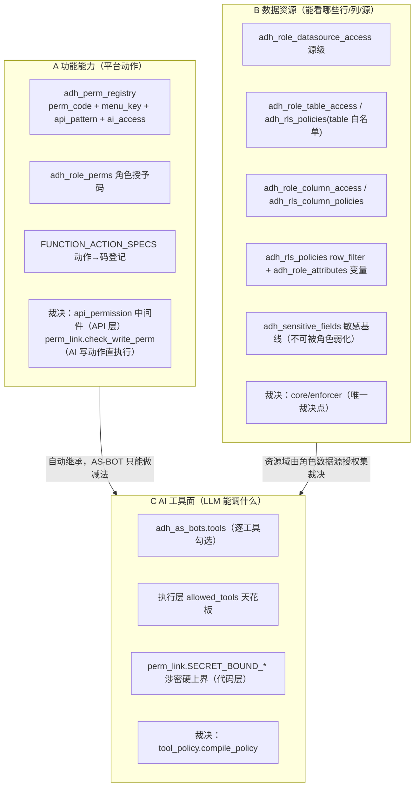

**为什么必须分开**：若用 A 的菜单权限码去门控 B 的取数工具，权限语义会与 `permission_enforcer` / `gates` 打架，
也会让「看板页能读指标」被误当成「可以执行 SQL」。UI 上同样分区展示，避免管理员误配。

### 6.3 角色 → AS-BOT → 生效能力（一条链）

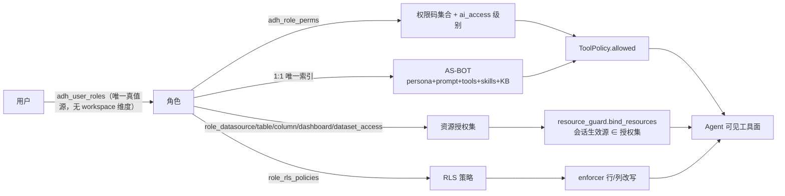

- 角色无 AS-BOT → 返回空列表（该角色没有智能体入口）。
- 域规则是**能力叠加**而非互斥：授权 `system` 工具组即获得系统能力面（系统本体可见、系统工具可调、系统源 0 可访问），业务能力照常继承；未授权则仅业务域（跨源业务本体 + 本绑定源的源本体）。旧 `__system_bot__` 哨兵与 `kind='source'` 独立通道已退役/退役中。
- 本体可见域**只用 `kind` 判别**（`system`/`business`，`source` 退役中），不得用 `datasource_id=0` 判系统本体（业务本体的 ds 也是 0，会误暴露/可写）。

### 6.4 功能权限码的 AI 级别与涉密硬上界

`adh_perm_registry.ai_access ∈ {none, read, write}` 是**可配置**级别，但不是最终裁决：
`perm_link.cap_level` 与 DB 配置取**更严者**，且返回收窄原因（不静默降级）。

| 上界 | 语义 | 典型 perm_code |
|---|---|---|
| `SECRET_BOUND_NONE_PERMS` | 恒为 none，根本不进 LLM 工具面 | 凭据类 `datasource:manage`/`mcp:*`/`model:manage`/`notification:*`；身份与权限 `user:*`/`role:*`/`system:users`/`system:roles`；安全边界 `rls:*`/`sandbox:*`/`asbot:*`/`sensitive:manage`；全局配置 `settings:*`；注入面 `prompt:*`/`skill:*`；物理 SQL `sql-pairs:*` |
| `SECRET_BOUND_READ_ONLY_PERMS` | 上限 read，禁止一切写 | `datasource:read`、`model:read`、`sensitive:read`、`audit:read`、`observability:read` |

判定口径：涉密项含①连接凭据/密钥/个人身份 ②本身是安全边界（可被 prompt injection 诱导放宽）③系统提示词（注入面）或物理 SQL/表列名（§7 黑盒）。

### 6.5 写动作唯一回路（菜单与功能权限码 + 工具授权直执行）

没有「提议→审批→执行」回路；执行前 `perm_link.require_write_perm(user_id, ws, perm_code, label)` fail-closed 把关，
拒绝原因可解释给用户。审计字段 `decided_by`/`approved_by` **由服务端注入**（不从请求体信任身份），
并发/重复执行由状态条件更新仲裁幂等（宁阻断勿重复落库）。

| 写动作 | 权限码 |
|---|---|
| `ontology.generate` / `save` / `activate` / `import_yaml` | `ontology:generate` / `ontology:save` / `ontology:activate` / `ontology:import` |
| `alias.approve` / `reject` | `ontology:save` |
| `metadata.sync` | `sync:manage` |
| `task.claim_owner` | `scheduled:manage` |
| `dashboard.publish` | `dashboard:manage` |
| `product.contract_change` | `dataset:manage` |

canonical 本体 `objects[].actions[]` 与 `rules[].permission` 只是**建模描述**（无运行时消费方），不作为执行把关依据。
新增写动作必须同批落地：权限码映射 + `require_write_perm` + 审计服务端注入 + fail-closed 用例；
无权限码映射的写动作不得上线，禁止任何「直接 UPDATE 派生表」的旁路。

### 6.6 数据源可用性的唯一裁决点（防猜值 / 防串味）

- 一个源能不能被使用，**唯一**由用户角色授权决定：`adh_user_roles ⋈ adh_role_datasource_access`
  → `role_service.get_user_allowed_datasources(user_id, workspace_id)` → `resource_guard.bind_resources` 的 `available_sources`。
- `adh_workspace_datasources` 已退役为**冻结表**（保留结构 + 删除工作空间时级联清理，任何读路径不得消费）；AS-BOT 也不持有数据源边界。
- **空角色授权不解释为全量**（fail-closed），admin 同样纯角色裁决不 bypass；消费方一律按 `datasource_id not in allowed` 拒绝，不得写 `if allowed and ...`（历史缺陷：`enforcer.py` L189-197 曾 fail-open）。
- 会话生效源 `ctx.datasource_id` 必须 ∈ 授权集：唯一候选自动选定、多候选要求显式选择、已选源被撤回则报错**不静默切换**。
- 工具入参**不得**要求 LLM 传 `datasource_id`（它拿不到真实值只能猜，必被 `_check_source` 拒并空耗多轮）：
  `list_datasources` 返回授权集内 `{name, db_type}`（不含 id），查询工具用可选 `datasource`（名），服务端在授权集内按 name 解析为 id（`name` 全局唯一 `uk_datasource_name`），未命中抛**含候选名的可操作错误**引导 `ask_user`，禁止猜名/猜 id。
- 跨源联邦的辅源同样由服务端按 **name** 解析（凭据解密后只在内部通道下发，不进 LLM/前端）；解析不到直接拒绝。

### 6.7 权限决策树（运行时视角）


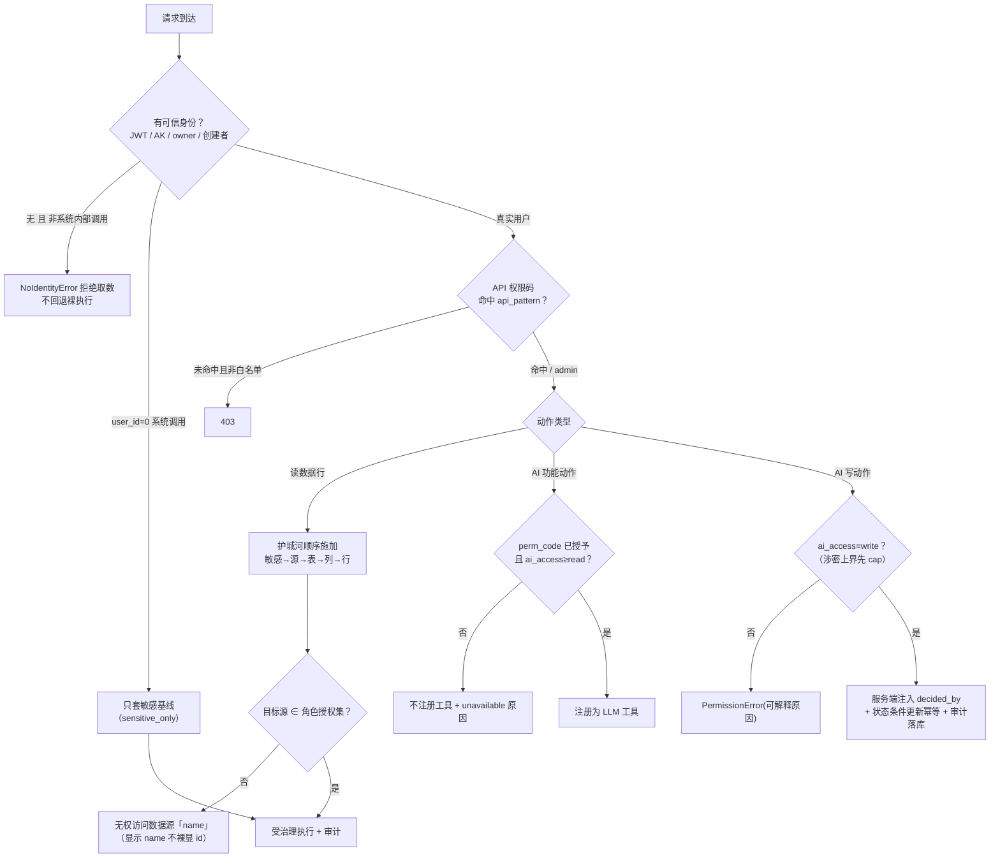

---

## 7. 数据模型分层（元库 `adh_*` 按域分组）

```mermaid
flowchart LR
    subgraph G1["身份与权限域"]
        T1["adh_users / adh_workspaces / adh_workspace_users<br/>adh_roles / adh_user_roles / adh_role_attributes<br/>adh_perm_registry / adh_role_perms<br/>adh_menu_registry / adh_menu_items / adh_role_menus / adh_role_apis"]
    end
    subgraph G2["资源授权域"]
        T2["adh_role_datasource_access / adh_role_table_access / adh_role_column_access<br/>adh_rls_policies / adh_rls_column_policies / adh_role_rls_policies<br/>adh_role_dashboard_access / adh_role_dataset_access / adh_dataset_scopes<br/>adh_sensitive_fields（治理基线）"]
    end
    subgraph G3["物理元数据与资产域"]
        T3["adh_datasources / adh_catalogs / adh_table_info / adh_column_metadata<br/>adh_meta_sync_state / adh_table_relations / adh_data_lineage<br/>adh_data_products / adh_data_product_versions / adh_datasets"]
    end
    subgraph G4["语义与本体域"]
        T4["adh_ontology_models（canonical doc 唯一事实源）<br/>adh_ontology_objects（展开行·派生） / adh_ontology_bindings（部署绑定）<br/>adh_metrics / adh_dimensions / adh_metric_dimensions<br/>adh_business_terms / adh_alias_suggestions / adh_ontology_kb_sync_state"]
    end
    subgraph G5["智能体与会话域"]
        T5["adh_as_bots（角色 1:1）/ adh_agent_sessions<br/>adh_conversations / adh_message_feedback / adh_chat_attachments<br/>adh_prompts / adh_prompt_versions / adh_knowledge_bases / adh_knowledge_items<br/>adh_user_assets / adh_workspace_assets / adh_user_memory / adh_execution_layers<br/>（adh_wakers / adh_role_wakers / adh_workspace_wakers = 已退役遗留表，代码不再消费）"]
    end
    subgraph G6["流程与加工域"]
        T6["adh_sync_tasks / adh_sync_logs / adh_sync_watermarks<br/>adh_dag_workflows / adh_dag_runs / adh_dag_node_runs / adh_etl_tasks<br/>adh_scheduled_tasks / adh_scheduled_logs / adh_system_jobs<br/>adh_udfs / adh_notification_channels"]
    end
    subgraph G7["消费与可观测域"]
        T7["adh_dashboards / adh_charts / adh_chart_snapshots / adh_vis_components / adh_reports<br/>adh_query_audit / adh_data_access_audit / adh_audit_logs / adh_rls_audit_logs<br/>adh_llm_traces / adh_llm_spans / adh_pipeline_metrics<br/>adh_eval_cases / adh_eval_runs / adh_eval_results / adh_eval_gate_policy / adh_evolution_candidates"]
    end
    G1 --> G2 --> G3 --> G4 --> G5 --> G6 --> G7
```

关键纪律（可核对）：

- **唯一可编辑源**：`adh_ontology_models.json_content`；`adh_ontology_objects`、YAML/MD、RDF 图、云文档全部派生，严禁独立编辑派生物。
- **物理与业务分离**：`adh_table_info`/`adh_column_metadata` 是物理元数据事实源；`adh_data_products` 是治理身份（`product_name` 全局唯一、数据源删除重建后 id 变 name 不变）；`adh_datasets` 是 BI 消费视图；本体通过部署绑定 `adh_ontology_bindings`（`object_key × datasource_name`）关联物理，**doc 内不含物理绑定**（`save_draft` 迁移性剥离 `execution_binding`，log 注明非静默）。
- **字典绑定**：`adh_metrics`/`adh_dimensions` 生效行必须有 `bound_object_key` 指向本体对象 key；指标须含 `formula|formula_dsl|formula_dialects` 之一 + `agg_type`，维度须含 `target_column`；`activate` 遇孤儿引用**硬阻断**，`save_draft` 只告警返回 `validation_warnings`。
- **枚举唯一源**：维度字典 `value_labels`（→ 单向联动本体 `properties[].enum`，图谱 `owl:oneOf` 只读投影）。
- **术语是缓冲区**：`adh_business_terms` 只保留尚未绑定对象/字典的纯业务黑话；收编后同义词落对象/字典 aliases。
- **级联失效作用域**：`_persist_bindings` 失效范围 = `model_id AND datasource_id=<doc 自有源>`；跨站部署绑定归部署脚本管（幂等 + 废弃行自动复活）——「这行的归属是谁在管」必须回答。

---

## 8. 三层数据架构（数据源 → 数据集/数据产品 → 本体）

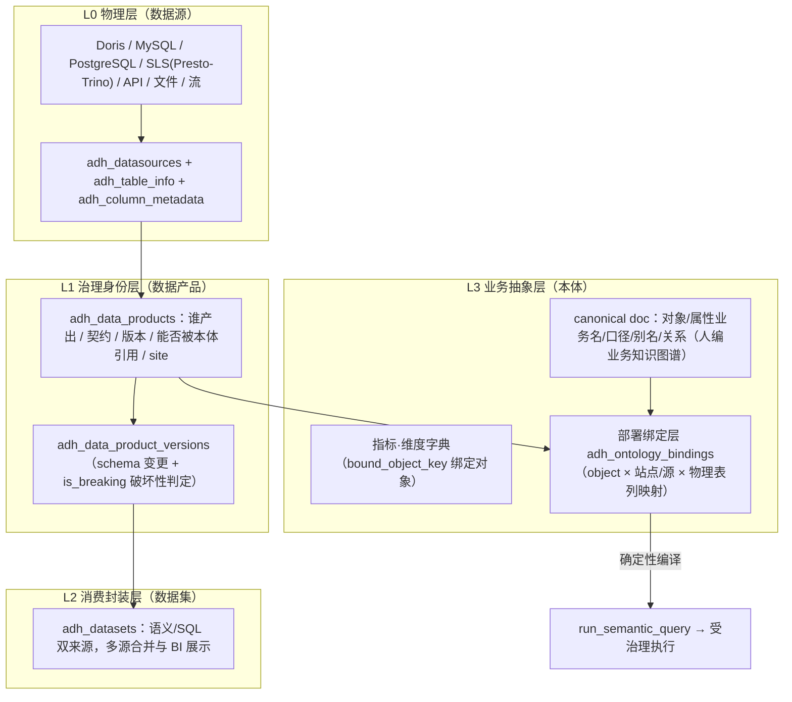

- 本体应通过**数据产品/部署绑定**间接关联数据源，不推荐直接绑裸物理表。
- 部署映射纪律（Q11 已拍板）：**工具全辅助生成 + 人工审业务层**——人编业务语义，物理列映射不手敲（错数风险，宁缺勿错）。
- `[过渡态]` `kind` 收缩已基本落地：`binding_resolver` 已按**域**（system vs 非 system）裁决绑定归属、doc 已剥离 `execution_binding`；`ontology_service` 的源本体生成路径仍产 `kind='source'` 作存量兼容，生成流程降级为「部署绑定引导」。

---

## 9. 跨站、联邦与执行引擎路由

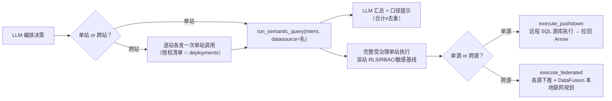

- **跨站是编排问题，不是 SQL 维度**：意图带「站点」维度 → 拒收回抛引导；服务端跨站展开/合并（`maybe_execute_cross_site` 等）已退役并有测试锁定，勿再引入。
- **为什么不是一条 UNION ALL**：五地独立 RDS 各走各的连接；逐站可独立过治理并逐站裁决授权（一源无权整句拒会违反 fail-closed）；故障隔离；站点来源与口径差异不被抹平。
- 职责三分：skill（静态：站点↔源映射/编排方法/红线/示例）、`list_datasources`（逐用户动态授权集）、`get_metrics.deployments`（事实源=部署绑定的顺风车字段）。
- 权限与失败语义：未授权站**静默裁剪**（作用域定义，不输出「其他站点/无权限」）；显式问无权站 → **拒绝**（fail-closed）；有权限但执行失败 → 标 `degraded` + 日志可诊断 + 轻描「部分站点暂无数据」；`sites_skipped` 只进审计不进对外叙事。
- 联邦演进条件（若将来要 UNION ALL / 库侧合计）：① 跨源语句的授权联合裁决语义；② RLS 注入对 UNION 各段逐段覆盖；③ 审计「一句 vs N 条」定口径。
- 方言纪律：治理层任何解析回写（LIMIT 强制、RLS 注入、投影保护）**必须用目标源自己的方言**（`dialect_of_db_type`：mysql/doris→mysql，postgres/sls→postgres）；用错方言会把 `"quoted_id"` 变字符串字面量、`ARRAY[]` 变 `ARRAY()`。

---

## 10. 关键设计决策（ADR 摘要）

| # | 决策 | 取舍理由 | 被拒方案 |
|---|---|---|---|
| 1 | web 单进程装配全部模块（端口收敛 8000） | 治理/权限逻辑常驻同一进程才有单一裁决点；重启即全局生效；省 8 份 CORS/中间件漂移 | 保留 8 进程壳（跨进程配置漂移、重复路由静默首匹配） |
| 2 | 本体 canonical JSON 为唯一可编辑源 | 派生视图一致性可由级联保证；避免多源真值漂移 | 页面直接编辑 MD/图谱/展开行 |
| 3 | `semantics.execute` 为全平台唯一取数口 | 语义/nl2sql 双轨共用一条治理链，杜绝"一条合规一条旁路" | 各入口自建执行通道 |
| 4 | 身份只信服务端，无身份 → `sensitive_only` 或拒绝 | 阻断 `body.user_id` 越权；内部调用仍不能绕过敏感基线 | 请求体传身份 / 无身份旁路 |
| 5 | 空角色授权 = 无权（fail-closed），admin 不 bypass 数据面 | 与 AS-BOT 角色唯一裁决点同口径，避免"未配即全量" | admin 数据面旁路 / 空集解释为全量 |
| 6 | 功能权限码与取数工具授权**正交分离** | 防止"看板可读指标"被误解为"可执行 SQL" | 用菜单权限码门控取数工具 |
| 7 | 写动作直执行（权限码 + 审计），无审批回路 | 双份判断会漂移；`decided_by` 服务端注入 + 幂等条件更新足以治理 | 保留提议→审批→执行三态机 |
| 8 | 工具入参禁 `datasource_id`，按业务名解析 | LLM 只能猜值 → 必被守卫拒并空耗轮次；name 全局唯一可解析 | schema 暴露 id 或让 LLM 自选 |
| 9 | 跨站由 LLM 逐站编排，语义层只管单站业务 SQL | 站点不是 SQL 维度；逐站授权/故障隔离/口径可诊断 | 服务端 scope 展开 + 合计行 |
| 10 | 元数据工具按 AS-BOT 工具授权分域（物理 vs 投影） | nl2sql 需要真实列才能写 SQL；语义 AS-BOT 不该看物理结构 | 统一一种返回 |
| 11 | 评测双口径门禁（相对基线 + 绝对下限/覆盖度） | 只卡回退会产生"长期坏着却报绿"的真实事故 | 只看 `baseline_ok` |
| 12 | RLS 视图化（plan 期强制）+ 上游改写后二次注入 | 视图天然覆盖 JOIN 两侧并消除别名风险；二次注入是纵深防御 | 单层子查询包裹 / 信任上游一次改写 |
| 13 | 检索走确定性路线（BM25/关键词/SPARQL by-name），退役 embedding 与 agentic SPARQL | 本体规模小、schema 全已知，形状可预先手写；LLM 探图成本高且不可复现 | LLM 多轮写 SPARQL 探图 |

---

## 11. 改动 → 回归门禁映射（改了哪层必须跑什么）

| 触碰面 | 必跑回归 |
|---|---|
| `enforcer.py` / `query_executor.py` / `governed_query.py` / `playground.py` / `semantic_query.py` / `df_serialize.py` | `tests/test_data_moat_enforcement.py`、`test_permission_enforcer.py`、`test_permission_e2e.py`（并补：带别名 JOIN 的 RLS、重名列、无可信身份拒绝、敏感 block 对 admin 生效） |
| `sdk_tools/query_tools.py`（`execute_sql`/`check_sql`） | `tests/test_execute_sql_governance.py`（锁定只经 `execute_query_with_permission`、权限拒在执行前中止、源码级禁 `get_connection`/裸 `execute_query`） |
| `resource_guard.py` / `sdk_tools/compat.py` / `scoped_metadata.py` / `catalog_tools.py` / `query_tools.py` 的数据源作用域或元数据返回 | `tests/test_as_bot_security.py`（含 `test_sql_capable_as_bot_metadata_tools_bypass_projection`、`test_tool_selects_source_by_authorized_name`、`test_tool_rejects_unknown_datasource_name`、`test_catalog_strip_physical_ids_keeps_modeling_columns`）+ 护城河三件套 |
| `ontology_service.py` / `ontology_kb_sync.py` / `semantics/{planner,models,intent,binding_resolver}.py` / `terminology_manager.py` | `venv/bin/python -m backend.eval.runner`（正确率不得回退；`--suite retrieval` 另跑检索评测）+ `test_cloud_md_redaction.py`、`test_doc_freshness.py`、`test_alias_suggestions.py`、`test_terminology_scoping.py`、`test_planner_resolution.py` |
| 新增 AS-BOT 写动作 | `tests/test_as_bot_execution.py`（fail-closed 用例）+ 同批落权限码映射/`require_write_perm`/审计服务端注入 |
| 新增「系统问题→数据源路由」（prompt/planner/工具描述） | eval 加用例断言系统运营问题不得命中业务本体 |
| 前端图页面 / 图接口 | `npx tsc --noEmit` 本次触碰文件零错误 + `vitest run` 全绿 + 人工核对（标题可读、连线可见且分层、详情面板不逐字符展开） |
| 跨站/契约相关 | `tests/test_cross_site.py`（锁定服务端展开已退役）、`test_binding_layer_separation.py`、`test_sync_stability.py` |
| prompt（`prompt_composer.py`）/ 别名字典 / 检索策略 / 本体导入导出 | 必跑 `venv/bin/python -m backend.eval.runner` 并对比基线（总与分 tag 正确率不得低于改前）；`tests/test_eval_baseline.py` 作为 pytest 门禁；新行为**先加用例再实现** |
| 自进化闭环（别名落入/归纳/审核回写） | `tests/test_alias_suggestions.py`、`tests/test_terminology_scoping.py`、`test_eval_retrieval_falsifiability.py`；回写必经 `save_draft` 级联（不得直接 UPDATE 派生表）|

部署生效方式：web 单进程无 `--reload` → `./stop-all.sh web && ./start-all.sh -d` 重启即全局生效；
异步面另有 celery-worker / beat（dataengine 已退役）；数据源配置唯一来源 `backend/.env`。

---

## 12. 已知风险与技术债（诚实清单）

| 风险 | 现状 | 建议处置 |
|---|---|---|
| CORS 全放开 `allow_origins=["*"]` 且 `allow_credentials=True` | `backend/app/main.py` 装配期固定，未走配置 | 生产按部署域收窄；或改为配置驱动（需要需求方拍板，不擅自改） |
| `_extract_tables` 对三段式限定名支持依赖 sqlglot 版本行为 | 护栏 §10 已要求 `catalog.db.table` 同步升级匹配键；治理路径已走 sqlglot | 新增跨库同名场景补 `test_cross_site`/moat 用例验证匹配键归一 |
| 权限 TTL 缓存窗口 | `check_access` 30s、角色 API 规则 60s；策略变更需显式 `invalidate_access_cache()` | 改权限配置的写路径确认是否已调用失效（未调用则最坏 30~60s 收敛延迟） |
| `kind='source'` 生成路径仍在 | `ontology_service` 若干处以 `datasource_id>0 → kind='source'` 落库，`binding_resolver` 已按域裁决 | 源本体退役（B6）收尾：生成流程改「部署绑定引导」，规则文本同步修订并展示 diff |
| 知识库同步默认纯手动 | `KB_SYNC_RECONCILE` 缺省关闭，水位线仍需失败可告警、可 `reconcile()` 自愈 | 上线后若出现 doc_stale 漂移，优先修水位线而非加自动重试 |
| admin 语义在文档与代码中的表述差 | 强规范文本写「admin 旁路（敏感脱敏除外）」，代码实际为**数据面不做 admin 旁路**（仅 API 中间件放行 + gates approval 免审批） | 以代码为准修订规范条文，避免"以为 admin 能看全量"的误判 |
| 计划稿与落地混写 | `docs/GLOBAL_SEMANTIC_LAYER_DESIGN.md` 标注「计划稿 v0.2」但内容已迭代到 v0.5，且 B1/B2/B3/B6b 已落地 | 在计划稿头部补「已落地批次」清单，防止引用旧计划当现状 |
| 继任函数无主链路调用方 | `evolution_service.record_parse_fail_terms` 自称 `record_unresolved_terms` 的继任，但全仓只有 API 层消费，取数主链路仍落 `adh_alias_suggestions`（双队列并存） | 要么接线继任者并退役旧路径，要么改注释声明“两者分工不同”——不得让读者误以为闭环已切换 |
| 代码内注释漂移 | `mind/rag/alias_suggestion.py` 文件头仍写“审核动作走 AS-BOT 审批（`adh_as_bot_role_actions` fail-closed 控权）”，与该表已退役事实（及 FDE §2「不得回潮」）矛盾；`as_bot.py` 头部注释才是现状 | 改注释对齐现状（防止后人据旧注释重建审批回路） |
| 端口口径表述差 | 规则文本写「web 单进程绑 8001-8007/8012 全部契约端口」，而 `backend/scripts/services.conf` 已收敛为单一 8000（`ss -ltnp` 实测只有一个监听），`serve.py` 按 conf 取端口去重后绑定 | 以代码为准修订规则文本 §6；本文按现状写 8000 |
| 退役审批回路仅退代码未退表 | `adh_as_bot_approvals` / `adh_as_bot_role_actions` / `adh_as_bot_action_registry` 结构仍在库（无 Python 消费） | 按「表退役与代码清理」口径归档或标冻结，避免被当作可用配置面误配 |

---

## 13. 一页速查（贴墙版）

```
入口   前端(权限码裁菜单) → web 单进程:8000 [CORS → API权限码 → Trace]
身份   JWT / 嵌入AK / 任务owner / 报表创建者 / HMAC内部头 —— 只信服务端，绝不信 body.user_id
Agent  角色1:1 AS-BOT → ToolPolicy(工具授权 ∩ 功能权限码 ∩ 执行层天花板 ∩ 涉密上界)
       资源域 = 用户角色数据源授权集（fail-closed，空=无权）；选源用业务名，不传 id
语义   LLM 只产 intent（禁裸SQL）→ intent → binding → planner → 七闸门
取数   semantics.execute 唯一口 → enforce_sql(敏感基线→RBAC→表→列→RLS) →
       DataFusion 下推/联邦（RLS 二次注入纵深）→ apply_post_processing → 审计
出站   df_to_columns_rows 消歧 → outbound_guard 剥 SQL/id/物理表/报错栈 → 只回业务视图
存储   MySQL(元库/权限/审计/评测) · Oxigraph(RDF/SPARQL) · Redis(缓存+Celery) · 对象存储 · QMind云KB
闭环   eval(L0-L3 四适配器 + 双口径门禁) ← evolution(信号→候选→人工四出口→回归)
演进   准确率三因子（意图约束 × 确定性编译 × 种子质量）——改动先归因子，后跑 eval 对比基线
       失败落 alias_suggestions → 人工直审(ontology:save) → save_draft 级联 → 重评（不靠拍脑袋堆别名）
       归因优先：无 resolution_sources / retrieval_source 分桶数据不做任何策略取舍
红线   不降级掩盖失败；不外泄物理细节；不弱化敏感基线；不绕过唯一取数口；不造第二写通道
```
